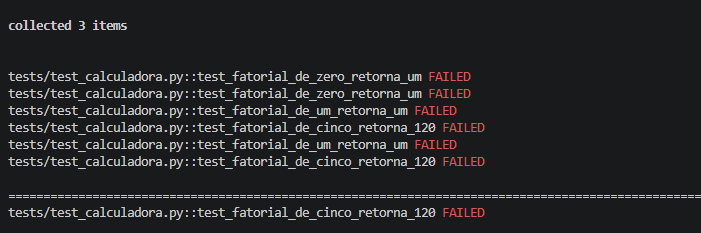
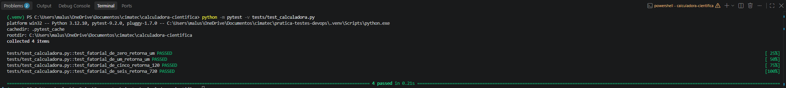

# Calculadora Científica em Python

Projeto acadêmico de análise e correção de defeitos em uma calculadora científica desenvolvida em Python, utilizando a metodologia Test-Driven Development (TDD).

## Objetivos

- Analisar o código-fonte e identificar defeitos.
- Documentar os bugs encontrados.
- Selecionar um defeito para correção.
- Aplicar o ciclo RED, GREEN e REFACTOR.
- Validar a correção por meio de testes automatizados.

## Tecnologias utilizadas

- Python 3.12
- NumPy
- Pytest
- Git e GitHub

## Estrutura do projeto

```text
calculadora-cientifica/
├── Calculadora.py
├── Bugs.md
├── README.md
├── requirements.txt
├── tests/
│   └── test_calculadora.py
└── evidencias/
    ├── tdd_red.png
    └── tdd_green.png
```

## Instalação

Clone o repositório:

```bash
git clone URL_DO_REPOSITORIO
```

Entre na pasta:

```bash
cd calculadora-cientifica
```

Instale as dependências:

```bash
python -m pip install -r requirements.txt
```

## Execução

Execute a calculadora:

```bash
python Calculadora.py
```

## Testes automatizados

Para executar os testes:

```bash
python -m pytest -v tests/test_calculadora.py
```

## Aplicação do TDD

O defeito selecionado foi o BUG-002, relacionado ao cálculo incorreto do fatorial.

### RED

Foram criados testes para verificar os resultados de `0!`, `1!` e `5!`.

Na implementação original, os três testes falharam, pois o laço começava em zero e multiplicava o acumulador por zero.



### GREEN

A função foi corrigida alterando o intervalo de iteração para começar em 1.

Após a alteração, os testes passaram.



### REFACTOR

A suíte de testes foi ampliada com um caso adicional para verificar o cálculo de `6! = 720`.

## Documentação dos defeitos

Os nove defeitos identificados na análise estão descritos no arquivo [Bugs.md](Bugs.md).

## Escopo da correção

A atividade de TDD concentrou-se na correção do BUG-002. Os demais defeitos estão documentados no relatório e não devem ser considerados corrigidos apenas por constarem nesta documentação.

## Autoria

Projeto desenvolvido como atividade acadêmica no SENAI CIMATEC.
